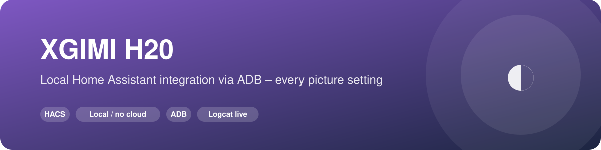
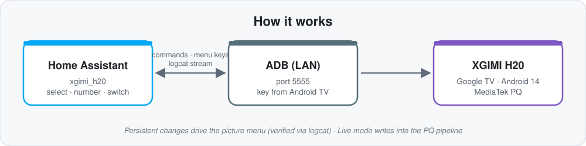
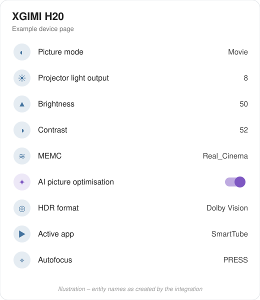
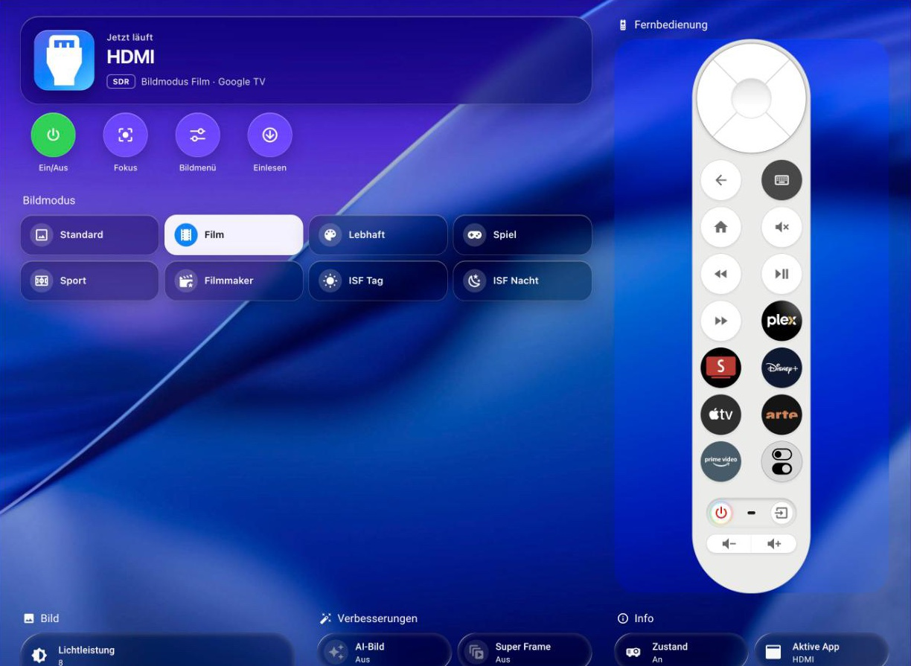
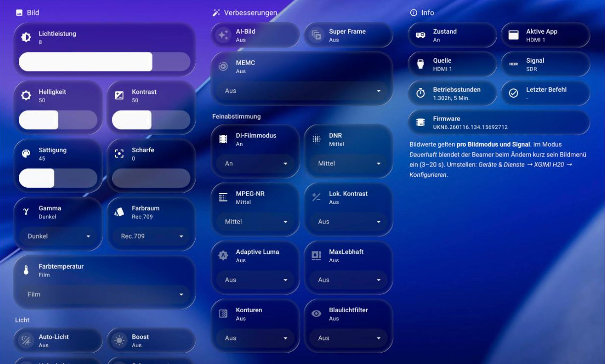

# XGIMI H20 für Home Assistant

[English](README.md) · **Deutsch**

[](https://hacs.xyz)



Vollwertige lokale Integration für den **XGIMI H20** (Google TV, Modell `XR13A`) – ohne Cloud und ohne Zusatz-App auf dem Beamer. Gesteuert wird alles über **ADB** im lokalen Netz.



> 🎛️ Mit fertigem [Liquid-Glass-Dashboard](#dashboard).

## Was geht

**Bildeinstellungen (lesen + schreiben)**

| Entität | Menü-Key (für `set_settings`) | Werte |
|---|---|---|
| Bildmodus | `picture_mode` | Standard, Movie, Vivid, ImaxEnhanced (HDR), Game, Sport, FilmMaker, User (ISF-Tag), Energy Saving (ISF-Nacht); bei Dolby Vision: DolbyVisionBright, DolbyVisionDark, DolbyVisionVivid, DolbyVisionIQ, DolbyVisionGame, DolbyVisionFilmmaker, DolbyVisionIQFilmmaker |
| Projektor-Lichtleistung | `picture_projector_brightness` | 1–10 |
| Helligkeit / Kontrast / Sättigung | `picture_brightness` / `picture_contrast` / `picture_saturation` | 0–100 |
| Schärfe | `picture_sharpness` | 0–20 |
| Farbtemperatur | `picture_projector_color_temperature` | Standard, D65, Movie, Color temperature 2, Fresh (je nach Bildmodus) |
| Gamma | `picture_gamma` | Dark, Middle, Bright |
| Farbraum | `picture_projector_color_space` | 4 = Nativ, 3 = Rec.709, 2 = DCI-P3, 1 = BT.2020, 7 = Adobe RGB |
| MEMC | `tv_picture_advance_video_mjc_effect` | Off, Real_Cinema, Low, Middle, High |
| AI-Bildoptimierung (AI PQ) | `tv_picture_video_aipq` | true / false |
| Rauschunterdrückung (DNR) | `tv_picture_advance_video_dnr` | Off, Low, Middle, High |
| MPEG-Rauschunterdrückung | `tv_picture_advance_video_mpeg_nr` | Off, Low, Middle, High |
| DI-Filmmodus | `tv_picture_video_di_film_mode` | Off, On (= Automatisch) |
| MaxLebhaft | `tv_picture_video_maxvivid` | Off, Low, Middle, High |
| Adaptive Luma-Steuerung | `tv_picture_video_adaptive_luma_control` | Off, Low, Middle, High |
| Lokaler Kontrast | `tv_picture_video_local_contrast_control` | Off, Low, Middle, High |
| Konturenglättung | `tv_picture_video_de_counter` | Off, Low, Middle, High |
| Niedriger Blaulichtanteil | `tv_picture_video_low_bluelight` | Off, Low, Middle, High |
| HDMI-RGB-Spektrum, PC-Modus | `tv_picture_video_hdmi_rgb_range`, `tv_picture_video_pc_mode` | Auto/Full/Limited, Off/On/Auto |
| Dyn. Schwarzwertverbesserung, Super Frame, Hohe Leistung, Leuchtdichte-Boost, Umgebungsangepasste Lichtleistung, Optischer Farbfilter, Filmmaker-Auto | Schalter | true / false |

Der H20 speichert Bildwerte **pro Profil** – also pro Quelle (Google TV, HDMI 1 …), Signaltyp (SDR, HDR10, HLG, Dolby Vision …) und Bildmodus. Die Integration merkt sich die Werte genauso: Startet ein Dolby-Vision-Film, zeigen die Entitäten die Werte des Dolby-Vision-Profils, danach wieder die des vorherigen. Einstellungen, die der Beamer im aktuellen Profil sperrt (z. B. *Hohe Leistung* bei Dolby Vision), erscheinen als „nicht verfügbar“.

**Status**: Betriebszustand (an / Bildschirmschoner / Standby / offline), Eingangsquelle, HDR-Format (SDR, HDR10, HLG, Dolby Vision …), aktive App mit ihrem echten Namen (z. B. „SmartTube", „Netflix"; bei HDMI der Eingang – der Name wird einmalig aus der App gelesen und gespeichert), Betriebsstunden, Firmware, letzter Befehl, native Live-Bildwerte (Diagnose).

**Aktionen**: Autofokus, Bildmenü öffnen, Bildeinstellungen einlesen, beliebige Tasten senden.



*Illustration – so sieht die Geräteseite in Home Assistant ungefähr aus.*

## Wie es funktioniert – und die zwei Schreibmodi

Die Bild-Datenbank des MediaTek-Chips ist für ADB gesperrt (nur System-Apps dürfen schreiben). Deshalb gibt es drei Wege, die die Integration automatisch wählt:

1. **XGIMI-Systemeinstellungen** (Lichtleistung, Farbraum, Farbtemperatur): werden direkt gesetzt – **unsichtbar und dauerhaft**, der XGIMI-Dienst übernimmt sie sofort.
2. **Dauerhaft (über das Bildmenü)** – Standard: Die Integration bedient das offizielle Bildmenü des Beamers per Fernbedienungs-Tasten. Das Seitenpanel ist dabei **3–20 Sekunden sichtbar**. Jeder Schritt wird über das Systemlog verifiziert, der Wert ist danach genau so gespeichert, als hättest du ihn per Fernbedienung geändert. Funktioniert in allen Sprachen der Firmware.
3. **Live (unsichtbar)**: Werte werden direkt in die Bildpipeline geschrieben – **sofort und unsichtbar**, aber **nicht dauerhaft** (weg beim App-/Quellenwechsel, das Beamer-Menü zeigt weiter den alten Wert). Pro-Stream-Werte (Helligkeit, Kontrast, Schärfe, AI PQ, lokaler Kontrast) wirken live nur während einer laufenden Wiedergabe. Bildmodus und Werte ohne nativen Schlüssel laufen immer über das Menü.

Den Modus stellst du jederzeit unter **Einstellungen → Geräte & Dienste → XGIMI H20 → Konfigurieren** um. Pro Aufruf lässt er sich im Dienst `xgimi_h20.set_settings` mit `mode: live` oder `mode: menu` überschreiben.

**Aktuelle Werte – ohne Menü**: Die Integration liest fast alles still mit:
- **Während ein SDR-Video läuft** (HDMI-Eingang oder App mit aktiver Wiedergabe) übernimmt sie alle 30 s die Werte direkt aus der Bildpipeline: Helligkeit, Kontrast, Sättigung, Schärfe, Gamma, Rauschunterdrückung, MPEG-NR, AI PQ, DI-Filmmodus, Adaptive Luma, lokaler Kontrast, MaxLebhaft, Konturenglättung, Blaulicht, HDMI-RGB, PC-Modus. Bei **HDR10** meldet die Pipeline einen Teil der Werte (Kontrast, Rauschunterdrückung, Konturen) aus einem anderen Stream, bei **Dolby Vision** gar keine aktuellen Werte – in diesen Profilen gelten deshalb die per Menü oder Logstream erfassten Werte (einmal „Bildeinstellungen einlesen" pro Profil genügt, HA merkt sie sich).
- **Bildmodus** (Standard, Film, Lebhaft, Spiel, Sport) aus dem XGIMI-Displaydienst; Dolby-Vision-, Filmmaker- und ISF-Modi aus dem Logstream.
- **Lichtleistung, Farbraum, Farbtemperatur, Super Frame, Hohe Leistung** aus den XGIMI-Systemeinstellungen.
- **Jede Änderung im Bildmenü** – auch per Fernbedienung – kommt über einen dauerhaften Logcat-Stream in Echtzeit an.

Nur MEMC-Stufe, dynamischer Schwarzwert, Leuchtdichte-Boost, Auto-Lichtleistung und Filmmaker-Automatik stehen nirgends außer im Menü. Für die gibt es den Button **„Bildeinstellungen einlesen"** bzw. die Option **„Neue Bildprofile automatisch einlesen"**, die das Menü nur bei einem noch völlig unbekannten Profil einmal liest. Der letzte Stand wird über Neustarts gespeichert.

## Installation

1. HACS → ⋮ → *Benutzerdefinierte Repositories* → `https://github.com/dr-apple/ha-xgimi-h20`, Kategorie *Integration* → installieren → Home Assistant neu starten.
2. Am Beamer ADB aktivieren: *Einstellungen → System → Info → 7× auf „Android TV OS-Build"*, dann *Entwickleroptionen → USB-Debugging / Netzwerk-Debugging*.
3. *Einstellungen → Geräte & Dienste → Integration hinzufügen → XGIMI H20* (wird auch automatisch per Zeroconf gefunden), IP-Adresse eintragen.
   - Ist die **Android-TV-Integration** von Home Assistant schon mit dem Beamer verbunden, wird deren Schlüssel (`.storage/androidtv_adbkey`) benutzt – es ist **keine neue Freigabe** nötig.
   - Sonst erzeugt die Integration einen eigenen Schlüssel; die Freigabe-Abfrage am Beamer mit „Immer zulassen" bestätigen.

## Dienste

```yaml
# Mehrere Werte auf einmal (ein Menü-Durchgang)
action: xgimi_h20.set_settings
data:
  device_id: <XGIMI H20>
  settings:
    picture_mode: Movie
    tv_picture_advance_video_mjc_effect: High
    picture_brightness: 52
  mode: menu   # optional: menu | live

# Alle Werte aus dem Menü einlesen (liefert sie auch als Antwort zurück)
action: xgimi_h20.read_picture_menu
data:
  device_id: <XGIMI H20>

# Tasten senden
action: xgimi_h20.send_keys
data:
  device_id: <XGIMI H20>
  keys: [HOME]
```

## KI-Bildoptimierung (optional)

Passt das Bild automatisch an das an, was gerade läuft: Serie oder Film, Genre und wie dunkel der Titel ist. Was du bei einem Titel von Hand nachstellst, merkt sie sich für genau diesen Titel und dieses HDR-Format.

**Voraussetzung:** die Integration [**Entertainment Profiler**](https://github.com/dr-apple/ha-entertainment-profiler). Er erkennt, welche App und welche Serie bzw. welcher Film läuft (`Plex|The Expanse`). Meldet sein Sensor zusätzlich die Attribute `media_kind` (`series` / `movie`) und `media_player`, unterscheidet die Bildoptimierung Serien und Filme (D65 nur bei Filmen) und gibt der KI die Inhaltsbeschreibung mit; ohne diese Attribute gilt jeder Titel als Serie. Für die Genre-Erkennung zusätzlich eine **KI-Aufgaben-Entität** (`ai_task`, z. B. von Anthropic, OpenAI, Google oder Ollama) – ohne KI gilt jeder Titel als Drama.

**Einrichten:** *Geräte & Dienste → XGIMI H20 → Konfigurieren*

| Option | Bedeutung |
|---|---|
| Entertainment-Profiler-Sensor | Der Sensor *Aktives Profil* des Profilers. Leer = Funktion aus. |
| KI-Entität für die Genre-Erkennung | Ordnet jeden neuen Titel **einmal** ein (Genre + hell/mittel/dunkel), das Ergebnis wird gespeichert. |
| Meldung auf dem Beamer an | Optional, z. B. die Entität von *Notifications for Android TV*: Nach jeder Anpassung erscheinen die geänderten Werte („Komödie, hell: Helligkeit 50 → 49, Sättigung 50 → 52“). Sie kommt erst, wenn der Profiler fertig ist, damit sich die Meldungen nicht überlagern. |

Danach gibt es den Schalter **KI-Bildoptimierung** (startet aus) und die Sensoren **KI-Bild Genre** und **KI-Bild letzte Änderung** (Attribut `changes`: Liste mit `name`, `old`, `new` – ideal für eine Tabelle im Dashboard). Zusätzlich feuert jede Anpassung das Ereignis `xgimi_h20_picture_ai_applied`.

**Was eingestellt wird** (20 s nach jedem Titel- oder HDR-Wechsel, nur abweichende Werte, live und unsichtbar; nur wenn der Profiler einen Serien- oder Filmtitel kennt – reine Apps wie YouTube bleiben unberührt):

| Genre | Lichtleistung · Helligkeit · Kontrast · Sättigung | Bildveredelung |
|---|---|---|
| Drama | 8 · 50 · 45 · 50 | – |
| Komödie | 8 · 50 · 45 · 52 | – |
| Action | 9 · 50 · 50 · 54 | – |
| Sci-Fi | 9 · 50 · 48 · 52 | – |
| Thriller | 7 · 49 · 46 · 48 | Lok. Kontrast Mittel, Adaptive Luma Niedrig |
| Horror | 7 · 48 · 48 · 46 | Lok. Kontrast Mittel, Adaptive Luma Niedrig |
| Animation | 9 · 50 · 48 · 58 | Schärfe 5, Rauschunterdrückung Niedrig, Konturenglättung Hoch |
| Doku | 8 · 50 · 46 · 52 | Schärfe 5, MaxLebhaft Niedrig |
| Sport | 10 · 50 · 50 · 54 | – |

- **Dunkle Titel:** Helligkeit +2, Lokaler Kontrast Mittel, Adaptive Luma Niedrig. **Helle Titel:** Helligkeit −1.
- **Filme:** Farbtemperatur D65, **Serien:** Farbtemperatur *Film*. Ist die Art unbekannt, bleibt die Farbtemperatur, wie sie ist.
- **Sonst immer:** Schärfe 3, Rauschunterdrückung Mittel, Lokaler Kontrast Aus, Adaptive Luma Aus, Konturenglättung Mittel, MaxLebhaft Aus – so bleibt nach einem Zeichentrick nichts „hängen“.
- **Lernen:** Änderst du Lichtleistung, Helligkeit, Kontrast, Sättigung, Bildmodus oder MEMC, während ein Titel seit mindestens 2 Minuten läuft, und lässt sie 90 s so, gelten diese Werte künftig für diesen Titel und dieses HDR-Format. Bildmodus und MEMC laufen über das Bildmenü (Panel kurz sichtbar) und werden nur aus gelernten Werten gesetzt.
- Was der Beamer im aktuellen Profil sperrt (z. B. MaxLebhaft bei Dolby Vision), wird übersprungen.

**Dienste:** `xgimi_h20.picture_ai_apply` (sofort anpassen, mit `dry_run: true` nur den Plan zurückgeben), `xgimi_h20.picture_ai_import` (Titel übernehmen, z. B. aus einer älteren eigenen Lösung), `xgimi_h20.picture_ai_forget` (Titel neu einordnen lassen).

## Dashboard

Ein fertiges Dashboard im Apple-/*Liquid-Glass*-Stil: „Jetzt läuft“-Karte mit HDR-Plakette, runde Kontrollzentrum-Knöpfe (Ein/Aus, Autofokus, Bildmenü, Einlesen), Bildmodus-Kacheln, die sich an SDR / Dolby Vision anpassen, eine komplette Fernbedienung und alle Bildeinstellungen gruppiert in *Bild*, *Verbesserungen*, *Feinabstimmung* und *Info*. Im Standby schrumpft es auf Ein/Aus-Knopf und Fernbedienung.





*Echte Screenshots mit dem optionalen visionOS-/Liquid-Glass-Theme.*

**So kommt es in dein Home Assistant**

1. Aus HACS (*Frontend*) installieren: [button-card](https://github.com/custom-cards/button-card) und [firemote-card](https://github.com/PRProd/HA-Firemote) (Fernbedienung).
2. Optional für den Look: das Theme [homeassistant-visionos-theme](https://github.com/Nezz/homeassistant-visionos-theme) („Liquid Glass“) – jedes dunkle Theme geht auch.
3. Neues Dashboard anlegen, öffnen → ✏️ → ⋮ → *Raw-Konfigurationseditor* und die View unter `views:` einfügen:
   - Deutsches Home Assistant: [`examples/dashboard-beamer.de.yaml`](examples/dashboard-beamer.de.yaml)
   - Englisches Home Assistant: [`examples/dashboard-beamer.en.yaml`](examples/dashboard-beamer.en.yaml)
4. Die drei Entitäten der anderen Integrationen durch deine ersetzen:

| In der YAML | Was es ist |
|---|---|
| `media_player.xgimi_h20_google_tv` | Beamer aus der Integration **Android TV Remote** (Ein/Aus-Knopf) |
| `remote.xgimi_h20_google_tv` | Remote-Entität derselben Integration (firemote-card) |
| `media_player.xgimi_h20_adb` | Beamer aus der Integration **Android TV** (ADB) (firemote-card) |

Alle `xgimi_h20_*`-Entitäten entsprechen den Standardnamen, die diese Integration für ein Gerät namens „XGIMI H20“ anlegt. Wer das Gerät umbenannt hat, ersetzt das Präfix per Suchen & Ersetzen. Für das Theme `theme: Liquid Glass` in der View ergänzen.

## Beispiele

**Filmabend-Szene** – Bildmodus Film, MEMC aus, Lichtleistung hoch (ein Menü-Durchgang):

```yaml
script:
  beamer_filmabend:
    alias: Beamer Filmabend
    sequence:
      - action: xgimi_h20.set_settings
        data:
          device_id: <XGIMI H20>
          settings:
            picture_mode: Movie
            tv_picture_advance_video_mjc_effect: "Off"
            picture_projector_brightness: 10
```

**Automatisch Bildmodus „Game“, wenn die Konsole am HDMI läuft:**

```yaml
triggers:
  - trigger: state
    entity_id: sensor.xgimi_h20_eingangsquelle
    to: HDMI 1   # genauen Zustand unter Entwicklerwerkzeuge → Zustände prüfen
actions:
  - action: select.select_option
    target:
      entity_id: select.xgimi_h20_bildmodus
    data:
      option: Game
```

Die Entity-IDs hängen vom Gerätenamen und der HA-Sprache ab – unter *Einstellungen → Geräte & Dienste → XGIMI H20* nachsehen.

## Fehlersuche

| Problem | Lösung |
|---|---|
| Verbindung schlägt fehl | Netzwerk-Debugging am Beamer an? Freigabe-Dialog am Beamer mit „Immer zulassen“ bestätigt? |
| Alles „nicht verfügbar“ | Der Beamer ist im Standby – dann ist ADB aus. Nach dem Einschalten kommen die Werte zurück. |
| Bildmenü blinkt kurz auf | Normal im Modus „Dauerhaft (über das Bildmenü)“. Für unsichtbare Änderungen den Live-Modus wählen. |
| Werte eines Profils fehlen | Einmal „Bildeinstellungen einlesen“ drücken – HA merkt sich das Profil. |

## Hinweise

- Getestet mit Firmware `UKN6.260116.134` (Android 14).
- Ein- und Ausschalten, Lautstärke und App-Start erledigen weiterhin die Android-TV- bzw. Google-Cast-Integration; diese Integration ergänzt alles rund ums Bild.
- Im Standby ist der Beamer per ADB nicht erreichbar – die Bild-Entitäten sind dann „nicht verfügbar", der Betriebszustand zeigt „offline".

Lizenz: MIT. Kein offizielles XGIMI-Projekt.
