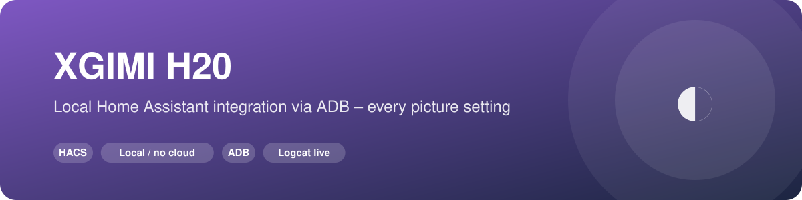
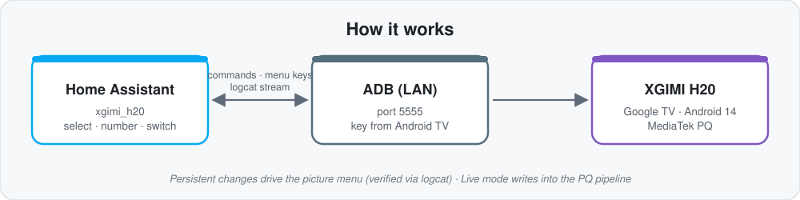
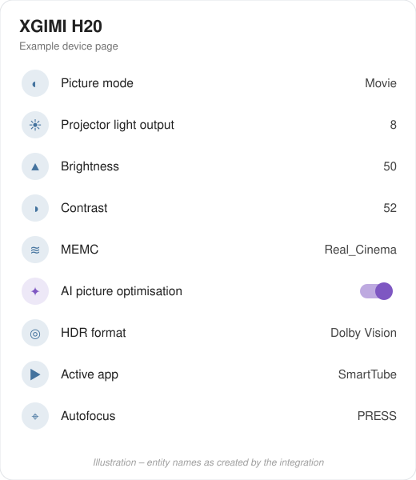
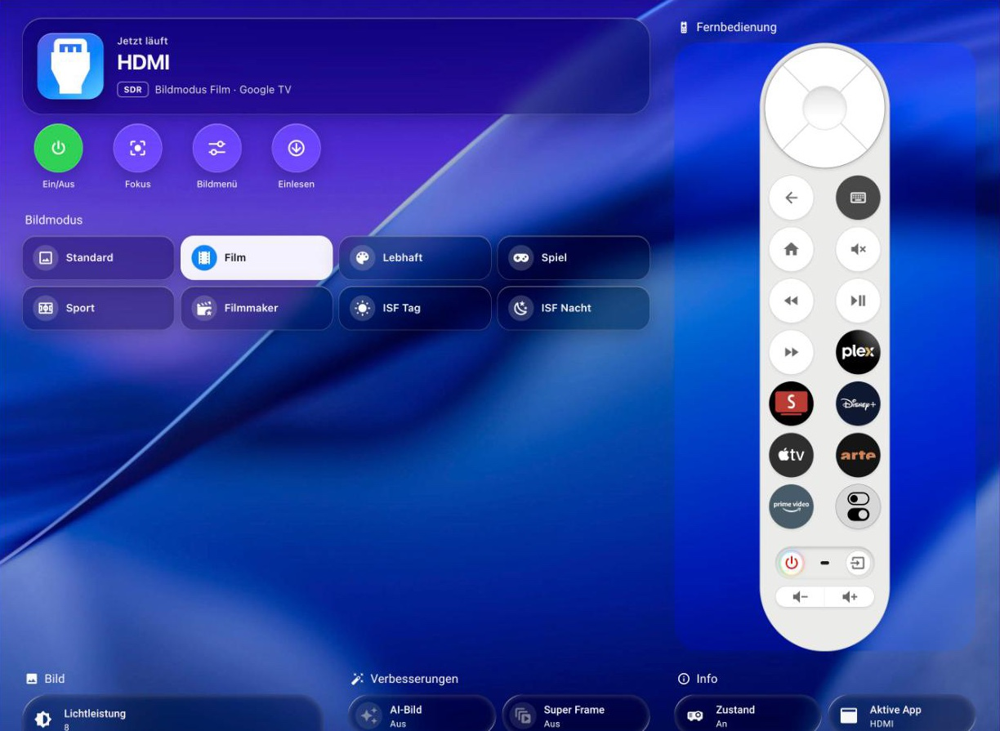
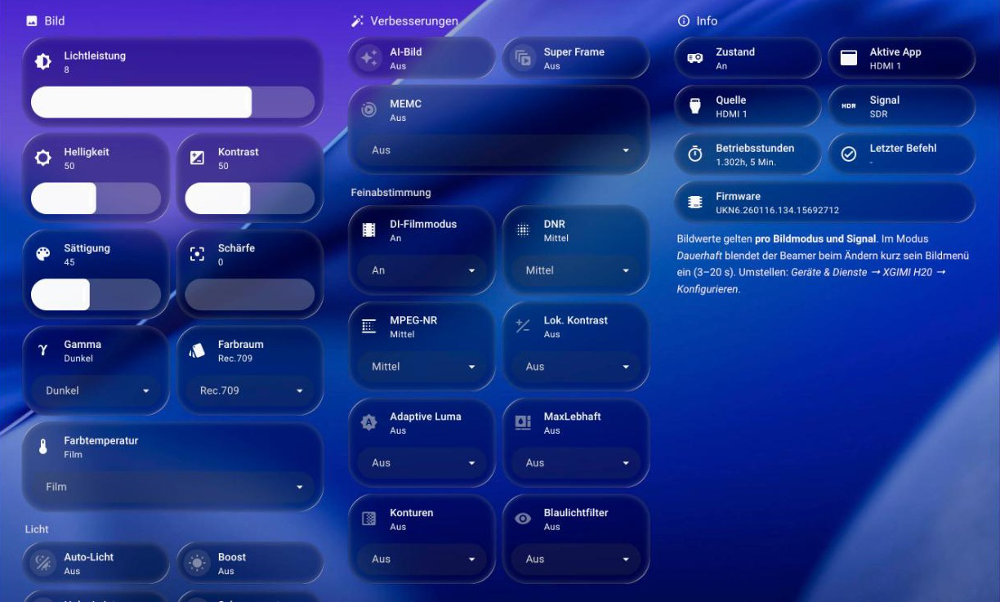

# XGIMI H20 for Home Assistant

**English** · [Deutsch](README.de.md)

[](https://hacs.xyz)



Full local integration for the **XGIMI H20** (Google TV, model `XR13A`) – no cloud and no extra app on the projector. Everything is controlled over **ADB** on your local network.



> 🎛️ Includes a ready-made [Liquid Glass dashboard](#dashboard).

## What you get

**Picture settings (read + write)**

| Entity | Menu key (for `set_settings`) | Values |
|---|---|---|
| Picture mode | `picture_mode` | Standard, Movie, Vivid, ImaxEnhanced (HDR), Game, Sport, FilmMaker, User (ISF day), Energy Saving (ISF night); with Dolby Vision: DolbyVisionBright, DolbyVisionDark, DolbyVisionVivid, DolbyVisionIQ, DolbyVisionGame, DolbyVisionFilmmaker, DolbyVisionIQFilmmaker |
| Projector light output | `picture_projector_brightness` | 1–10 |
| Brightness / contrast / saturation | `picture_brightness` / `picture_contrast` / `picture_saturation` | 0–100 |
| Sharpness | `picture_sharpness` | 0–20 |
| Colour temperature | `picture_projector_color_temperature` | Standard, D65, Movie, Color temperature 2, Fresh (depends on picture mode) |
| Gamma | `picture_gamma` | Dark, Middle, Bright |
| Colour space | `picture_projector_color_space` | 4 = Native, 3 = Rec.709, 2 = DCI-P3, 1 = BT.2020, 7 = Adobe RGB |
| MEMC | `tv_picture_advance_video_mjc_effect` | Off, Real_Cinema, Low, Middle, High |
| AI picture optimisation (AI PQ) | `tv_picture_video_aipq` | true / false |
| Noise reduction (DNR) | `tv_picture_advance_video_dnr` | Off, Low, Middle, High |
| MPEG noise reduction | `tv_picture_advance_video_mpeg_nr` | Off, Low, Middle, High |
| DI film mode | `tv_picture_video_di_film_mode` | Off, On (= automatic) |
| MaxVivid | `tv_picture_video_maxvivid` | Off, Low, Middle, High |
| Adaptive luma control | `tv_picture_video_adaptive_luma_control` | Off, Low, Middle, High |
| Local contrast | `tv_picture_video_local_contrast_control` | Off, Low, Middle, High |
| Contour smoothing | `tv_picture_video_de_counter` | Off, Low, Middle, High |
| Low blue light | `tv_picture_video_low_bluelight` | Off, Low, Middle, High |
| HDMI RGB range, PC mode | `tv_picture_video_hdmi_rgb_range`, `tv_picture_video_pc_mode` | Auto/Full/Limited, Off/On/Auto |
| Dynamic black level, Super Frame, High performance, Luminance boost, Ambient-adaptive light output, Optical colour filter, Filmmaker auto | switches | true / false |

The H20 stores picture values **per profile** – per source (Google TV, HDMI 1 …), signal type (SDR, HDR10, HLG, Dolby Vision …) and picture mode. The integration remembers values the same way: when a Dolby Vision film starts, the entities show the values of the Dolby Vision profile, afterwards those of the previous one again. Settings the projector locks in the current profile (e.g. *High performance* with Dolby Vision) show as "unavailable".

**Status**: power state (on / screensaver / standby / offline), input source, HDR format (SDR, HDR10, HLG, Dolby Vision …), active app with its real name (e.g. "SmartTube", "Netflix"; for HDMI the input – the name is read once from the app and stored), operating hours, firmware, last command, native live picture values (diagnostic).

**Actions**: autofocus, open the picture menu, read picture settings, send any key.



*Illustration – roughly what the device page looks like in Home Assistant.*

## How it works – and the two write modes

The MediaTek chip's picture database is locked for ADB (only system apps may write). That is why there are three paths, chosen automatically:

1. **XGIMI system settings** (light output, colour space, colour temperature): set directly – **invisible and persistent**, the XGIMI service applies them immediately.
2. **Persistent (via the picture menu)** – default: the integration operates the projector's official picture menu with remote-control keys. The side panel is **visible for 3–20 seconds**. Every step is verified via the system log; afterwards the value is stored exactly as if you had changed it with the remote. Works in every firmware language.
3. **Live (invisible)**: values are written directly into the picture pipeline – **instant and invisible**, but **not persistent** (lost on app/source change, the projector menu keeps showing the old value). Per-stream values (brightness, contrast, sharpness, AI PQ, local contrast) only take effect live while something is playing. Picture mode and values without a native key always go through the menu.

Switch the mode at any time under **Settings → Devices & services → XGIMI H20 → Configure**. Per call it can be overridden in `xgimi_h20.set_settings` with `mode: live` or `mode: menu`.

**Current values – without the menu**: the integration silently reads almost everything:
- **While an SDR video is playing** (HDMI input or an app with active playback) it takes all values from the picture pipeline every 30 s: brightness, contrast, saturation, sharpness, gamma, noise reduction, MPEG NR, AI PQ, DI film mode, adaptive luma, local contrast, MaxVivid, contour smoothing, blue light, HDMI RGB, PC mode. With **HDR10** the pipeline reports some values (contrast, noise reduction, contours) from a different stream, with **Dolby Vision** no current values at all – in these profiles the values captured via the menu or the log stream apply (pressing "Read picture settings" once per profile is enough, HA remembers them).
- **Picture mode** (Standard, Movie, Vivid, Game, Sport) from the XGIMI display service; Dolby Vision, Filmmaker and ISF modes from the log stream.
- **Light output, colour space, colour temperature, Super Frame, High performance** from the XGIMI system settings.
- **Every change in the picture menu** – also via the remote – arrives in real time through a persistent logcat stream.

Only the MEMC level, dynamic black level, luminance boost, auto light output and Filmmaker auto exist nowhere but in the menu. For those there is the **"Read picture settings"** button or the option **"Automatically read new picture profiles"**, which reads the menu only once for a completely unknown profile. The last state is kept across restarts.

## Installation

1. HACS → ⋮ → *Custom repositories* → `https://github.com/dr-apple/ha-xgimi-h20`, category *Integration* → install → restart Home Assistant.
2. Enable ADB on the projector: *Settings → System → About → tap "Android TV OS build" 7×*, then *Developer options → USB debugging / Network debugging*.
3. *Settings → Devices & services → Add integration → XGIMI H20* (also discovered automatically via Zeroconf), enter the IP address.
   - If Home Assistant's **Android TV integration** is already connected to the projector, its key (`.storage/androidtv_adbkey`) is reused – **no new authorisation** is needed.
   - Otherwise the integration creates its own key; confirm the prompt on the projector with "Always allow".

## Services

```yaml
# Several values at once (one pass through the menu)
action: xgimi_h20.set_settings
data:
  device_id: <XGIMI H20>
  settings:
    picture_mode: Movie
    tv_picture_advance_video_mjc_effect: High
    picture_brightness: 52
  mode: menu   # optional: menu | live

# Read all values from the menu (also returned as the response)
action: xgimi_h20.read_picture_menu
data:
  device_id: <XGIMI H20>

# Send keys
action: xgimi_h20.send_keys
data:
  device_id: <XGIMI H20>
  keys: [HOME]
```

## Dashboard

A ready-made dashboard view in an Apple / *Liquid Glass* style: "Now playing" card with HDR badge, round control-centre buttons (power, autofocus, picture menu, read settings), picture-mode tiles that adapt to SDR / Dolby Vision, a full remote, and every picture setting grouped into *Picture*, *Enhancements*, *Fine tuning* and *Info*. In standby it collapses to the power button and the remote.





*Real screenshots (German UI) with the optional visionOS / Liquid Glass theme.*

**Get it running**

1. Install from HACS (*Frontend*): [button-card](https://github.com/custom-cards/button-card) and [firemote-card](https://github.com/PRProd/HA-Firemote) (remote).
2. Optional for the look: the theme [homeassistant-visionos-theme](https://github.com/Nezz/homeassistant-visionos-theme) ("Liquid Glass") – any dark theme works too.
3. Create a new dashboard, open it → ✏️ → ⋮ → *Raw configuration editor* and paste the view under `views:`:
   - English Home Assistant: [`examples/dashboard-beamer.en.yaml`](examples/dashboard-beamer.en.yaml)
   - German Home Assistant: [`examples/dashboard-beamer.de.yaml`](examples/dashboard-beamer.de.yaml)
4. Replace the three entities of the other integrations with yours:

| In the YAML | What it is |
|---|---|
| `media_player.xgimi_h20_google_tv` | projector from the **Android TV Remote** integration (power button) |
| `remote.xgimi_h20_google_tv` | remote entity of the same integration (firemote-card) |
| `media_player.xgimi_h20_adb` | projector from the **Android TV** (ADB) integration (firemote-card) |

All `xgimi_h20_*` entities match the default names this integration creates for a device called "XGIMI H20". If you renamed the device, search & replace the prefix. To use the theme, add `theme: Liquid Glass` to the view.

## Examples

**Movie night script** – picture mode Movie, MEMC off, full light output (one menu pass):

```yaml
script:
  projector_movie_night:
    alias: Projector movie night
    sequence:
      - action: xgimi_h20.set_settings
        data:
          device_id: <XGIMI H20>
          settings:
            picture_mode: Movie
            tv_picture_advance_video_mjc_effect: "Off"
            picture_projector_brightness: 10
```

**Switch to "Game" automatically when the console on HDMI 1 is active:**

```yaml
triggers:
  - trigger: state
    entity_id: sensor.xgimi_h20_input_source
    to: HDMI 1   # check the exact state under Developer tools → States
actions:
  - action: select.select_option
    target:
      entity_id: select.xgimi_h20_picture_mode
    data:
      option: Game
```

Entity IDs depend on the device name and HA language – look them up under *Settings → Devices & services → XGIMI H20*.

## Troubleshooting

| Problem | Fix |
|---|---|
| Connection fails | Network debugging enabled on the projector? Prompt on the projector confirmed with "Always allow"? |
| Everything "unavailable" | The projector is in standby – ADB is off then. Values return after power-on. |
| Picture menu flashes briefly | Normal in "Persistent (via picture menu)" mode. Use live mode for invisible changes. |
| Values of a profile are missing | Press "Read picture settings" once – HA remembers the profile. |

## Notes

- Tested with firmware `UKN6.260116.134` (Android 14).
- Power, volume and app launch are still handled by the Android TV or Google Cast integration; this integration adds everything around the picture.
- In standby the projector cannot be reached via ADB – picture entities are "unavailable" then and the power state shows "offline".

License: MIT. Not affiliated with XGIMI.
